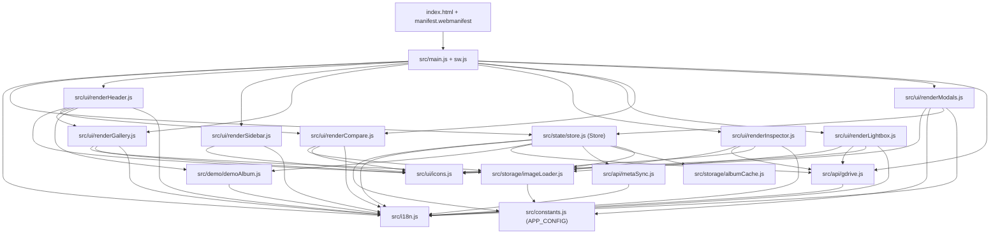

# DriveLens · Architecture & Engineering Design

> **Overview**: DriveLens is a zero-build, installable (PWA), pure client-side native ES Modules web application for browsing and collaboratively culling **Google Drive** shared photo albums. It supports **API Key Direct Connect** (with optional local `/api/meta` multiplayer sync via `serve.py`) and **OAuth 2.0 Account Sign-In** (with conflict-free cloud metadata sync inside `.drivelens/`), persistent credential auto-reconnect, and a strict-English-default bilingual (`en` / `zh`) runtime with all Chinese strings isolated solely inside [`src/i18n.js`](src/i18n.js).  
> **Project Independence**: DriveLens draws UX inspiration from [julyx10/lap](https://github.com/julyx10/lap) for its darkroom layout, rapid rating shortcuts, and comparison flow, while remaining a completely independent browser-native architecture built from scratch for Google Drive collaboration.

---

## 1. Zero-Build & Installable PWA Architecture

### 1.1 Native ES Modules + Python Static/Sync Server + Static Hosting

- **Native Browser ES Modules (`<script type="module" src="./src/main.js">`)**: Eliminates Node.js, npm, bundlers, and transpilation steps while maintaining clean modular boundaries across API, storage, state, i18n, demo, and UI layers.
- **Zero-Dependency Python Server ([`serve.py`](serve.py)) & Pure-ASCII Launcher ([`start.bat`](start.bat))**:
  - `NoCacheStaticHandler` overrides Windows MIME registry quirks by explicitly mapping `.js`/`.mjs` to `application/javascript; charset=utf-8`, `.css` to `text/css; charset=utf-8`, `.webmanifest` to `application/manifest+json`, and `.png` to `image/png`, with `Cache-Control: no-cache, no-store, must-revalidate`.
  - `serve.py` parses `--open` (opens `http://localhost:<port>` after socket bind, or attaches to an already-running instance on `EADDRINUSE` / `WinError 10048`) and `--dry-run` (verifies socket binding and prints `READY http://localhost:<actual_port>`).
  - `start.bat` uses 100% pure ASCII with strict CRLF (`\r\n`) line endings (no `chcp`) to avoid `cmd.exe` seek/encoding failures on Windows.
- **Static Host Compatibility**: The static asset tree deploys directly to GitHub Pages (with `.nojekyll`), Cloudflare Pages, or Netlify Drop. Relative `./` asset and PWA scope URLs prevent origin-root collisions on subpath hosts (such as `/drivelens/`). When `/api/meta` is absent on a static host, API Key mode smoothly falls back to `localStorage`, while OAuth mode syncs directly with Google Drive.

### 1.2 Installable PWA & Service Worker (`manifest.webmanifest`, `sw.js`, `icons/`)

- **Web App Manifest ([`manifest.webmanifest`](manifest.webmanifest))**:
  - Declares `"name": "DriveLens · Shared Drive Photo Gallery"`, `"short_name": "DriveLens"`, `"display": "standalone"`, `"display_override": ["window-controls-overlay", "standalone"]`, `"background_color": "#0b0e14"`, and `"theme_color": "#0b0e14"`.
  - Uses relative `"start_url": "./"` and `"scope": "./"` so the PWA installs cleanly at both root origins (`http://localhost:5173/`) and repository subpaths.
  - References three dedicated icons in `icons/`: `./icons/icon-192.png` (`192x192` RGBA PNG), `./icons/icon-512.png` (`512x512` RGBA PNG), and `./icons/icon.svg` (scalable `any maskable` vector icon).
- **Document Shell Meta Tags ([`index.html`](index.html))**:
  - Includes `<meta name="viewport" content="width=device-width, initial-scale=1.0, viewport-fit=cover" />`, `<meta name="theme-color" content="#0b0e14" />`, `<meta name="apple-mobile-web-app-capable" content="yes" />`, `<meta name="apple-mobile-web-app-status-bar-style" content="black-translucent" />`, `<meta name="apple-mobile-web-app-title" content="DriveLens" />`, `<link rel="manifest" href="./manifest.webmanifest" />`, and `<link rel="apple-touch-icon" href="./icons/icon-192.png" />`.
- **Service Worker ([`sw.js`](sw.js))**:
  - Maintains `CACHE_NAME = 'drivelens-shell-v8'` and precaches `PRECACHE_ASSETS` (14 local shell paths: `./`, `./index.html`, `./manifest.webmanifest`, all 3 icons, all 4 CSS stylesheets, `src/main.js`, `src/constants.js`, `src/i18n.js`, and `src/storage/albumCache.js`) during `install`, calling `self.skipWaiting()`.
  - Deletes older `drivelens-*` cache buckets during `activate` and calls `self.clients.claim()`.
  - Intercepts only same-origin `GET` requests excluding `/api/` paths (so `serve.py` `/api/meta`, Google Drive API calls, GIS scripts, and `googleusercontent.com` thumbnails always bypass the Service Worker cache). Uses a **Network-First** strategy that refreshes cached `response.type === 'basic'` assets online and falls back to `caches.match()` or `./index.html` (for navigations) when offline.
- **Install Prompt Lifecycle (`src/main.js`, `src/state/store.js`, `src/ui/renderHeader.js`)**:
  - On `window` `load`, `src/main.js` registers `./sw.js` with `{ scope: './' }` when running over `https:`, `localhost`, or `127.0.0.1`.
  - Browser `beforeinstallprompt` events call `event.preventDefault()` and pass the deferred prompt to `store.setInstallPrompt(event)`, exposing the top-header `[data-header="install-app"]` button in `renderHeader.js` (`!state.canInstallPwa` toggles `.hidden`).
  - Clicking **Install App** invokes `store.promptInstallPwa()`, and the browser's `appinstalled` event calls `store.onAppInstalled()` to clear the prompt state and display a toast confirmation.

### 1.3 Dual-Mode Runtime & Startup Auto-Reconnect Data Flow

```text
Browser / Installed PWA Startup (src/main.js)
  ├── Service Worker: register ./sw.js ({ scope: './' }) on https:/localhost/127.0.0.1
  ├── URL Hash Check (#folder=..., #lang=...):
  │     ├── Folder in hash -> connect via API Key (?key=...) or OAuth 2.0 (?client_id=...)
  │     └── No folder in hash -> store.restoreSavedSession()
  │           ├── Remember + autoConnect (API Key) -> silent connectWithApiKey()
  │           ├── Remember + autoConnect (OAuth)
  │           │     ├── Unexpired token in drivelens_session_v1 -> silent connectGoogleDrive({ reuseSession: true })
  │           │     └── Expired token -> open Connect modal with drivelens_oauth_user_v1 email hint + toast
  │           └── Otherwise -> stay in Offline Demo Album (src/demo/demoAlbum.js)
  ├── Mode 1 — API Key Direct Connect (Zero-OAuth):
  │     ├── Auth: Drive API Key (?key=AIzaSy...) + link-shared Drive folder + local nickname
  │     ├── Media: Drive API v3 -> thumbnailLink / drive.google.com/thumbnail / lh3 / alt=media + IndexedDB
  │     └── Sync: serve.py GET/POST /api/meta (.local-meta/<folder>.json) -> fallback localStorage
  ├── Mode 2 — OAuth 2.0 Account Sign-In:
  │     ├── Auth: Google Identity Services (GIS) -> Token Flow -> drivelens_session_v1 + drivelens_oauth_user_v1
  │     ├── Media: Drive API v3 (Bearer Token, private/Shared Drives, authorized video stream)
  │     └── Sync: Google Drive .drivelens/ (tags-schema.json + member-<key>.json) -> read-only localStorage
  └── Offline Demo Layer (src/demo/demoAlbum.js):
        └── Pure i18n.js-driven EN/ZH SVG dataset (5 folders, 16 media, 3 personas) + localStorage (drivelens_demo_state_v1)
```

---

## 2. Directory Map & Module Dependency Graph

### 2.1 Directory Structure

```text
drivelens/
├── index.html                   # Single-page shell (<html lang="en">, viewport-fit=cover), PWA meta links, 14 mount IDs
├── manifest.webmanifest         # Web App Manifest (relative ./ scope, standalone display, icon references)
├── sw.js                        # Service Worker (drivelens-shell-v8 precache, Network-First same-origin shell cache)
├── icons/
│   ├── icon.svg                 # Scalable vector app icon (any maskable)
│   ├── icon-192.png             # 192x192 RGBA PNG app icon & apple-touch-icon
│   └── icon-512.png             # 512x512 RGBA PNG splash/install icon
├── serve.py                     # Python 3 stdlib static server (incl. .webmanifest/.png) + /api/meta sync + --open/--dry-run
├── start.bat                    # Pure ASCII + CRLF Windows launcher invoking serve.py 5173 --open
├── .gitignore                   # Ignores __pycache__/, .local-meta/, config.js, .env*, *credentials*, *secret*, keys
├── .nojekyll                    # Disables Jekyll processing on GitHub Pages
├── .local-meta/                 # Runtime-only directory created by serve.py for API Key /api/meta JSON files
├── README.md                    # English user, PWA install, mobile touch, credential, and deployment guide (0 CJK)
├── ARCHITECTURE.md              # System architecture documentation (this file, 0 CJK chars)
├── verify_project.py            # Stdlib verification suite ([a]–[j]: HTTP, ES modules, DOM, PWA, Mobile UX, i18n)
├── styles/
│   ├── tokens.css               # Dark/light theme variables, safe-area inset tokens, touch-action manipulation
│   ├── layout.css               # Header, workspace, mobile nav bar, drawer headers/backdrop, mobile breakpoints
│   ├── components.css           # Cards, touch select targets, 16px mobile inputs, mobile Lightbox, bottom-sheet modals
│   └── compare.css              # Fullscreen 2–4 photo compare overlay, touch-action: none, stacked/2x2 phone grid
└── src/
    ├── main.js                  # Entry point, SW registration, beforeinstallprompt, mobile nav/drawer, shortcuts
    ├── constants.js             # Empty runtime defaults (DEFAULT_API_KEY/CLIENT_ID/FOLDER_ID), concurrency/debounce
    ├── i18n.js                  # Bilingual EN/ZH dictionary (444 mirrored keys); sole repository home for CJK strings
    ├── api/
    │   ├── gdrive.js            # GIS OAuth + hint/remember persistence, API Key & OAuth BFS crawlers, original download
    │   └── metaSync.js          # Cloud .drivelens/ LWW+isolated member sync & non-throwing ./api/meta helpers
    ├── storage/
    │   ├── albumCache.js        # IndexedDB + localStorage SWR cache (up to 12 albums; zero credentials stored)
    │   └── imageLoader.js       # 6-concurrency queue, IntersectionObserver, thumbnail fallback & 400-blob IDB cache
    ├── state/
    │   └── store.js             # Pub/sub Store, SWR cache hydration/revalidation, UI prefs, language, sync
    ├── demo/
    │   └── demoAlbum.js         # Zero-CJK bilingual demo builder reading MESSAGES[code] from src/i18n.js
    └── ui/
        ├── icons.js             # Inline SVG icons (incl. waterfall, globe & appWindow) & XSS escaping helpers
        ├── renderHeader.js      # Header skeleton, 3-view switcher, #langSelect, #mobileNavBar tabs, search popover
        ├── renderSidebar.js     # Mobile drawer header, gallery views switcher, folders, filters, tags
        ├── renderGallery.js     # Justified/Waterfall (computeWaterfallColumns)/Grid, subbar, batch bar, touch UX
        ├── renderInspector.js   # Mobile drawer header across all states, preview reuse, note guard, localized EXIF
        ├── renderLightbox.js    # Fullscreen lightbox (2048px / video stream / iframe), touch pinch/pan/swipe, filmstrip
        ├── renderCompare.js     # 2–4 pane compare with mouse + touch pinch/double-tap/synced drag-pan & inline HUD
        └── renderModals.js      # 2-tab Connect (remember checkbox, saved account hint, forget btn), Tag, Export, Help
```

### 2.2 Module Dependency Graph



### 2.3 Module Exports Summary

| Module | Key Exports | Responsibility |
| --- | --- | --- |
| `src/constants.js` | `APP_CONFIG` | Empty credential placeholders, `THUMBNAIL_CONCURRENCY` (`12`), `DRIVE_LIST_PAGE_SIZE` (`1000`), `DRIVE_MAX_RETRIES` (`4`), `DRIVE_MAX_BACKOFF_MS` (`32000`), `SYNC_DEBOUNCE_MS` (`800`) |
| `src/i18n.js` | `SUPPORTED_LANGS`, `MESSAGES`, `getLang`, `setLangCode`, `getLocaleTag`, `t` | Strict `'en'`-default localization runtime, 444-key EN/ZH parity, `{param}` interpolation, sole CJK string store |
| `serve.py` | `create_server`, `NoCacheStaticHandler`, `ReusableThreadingHTTPServer` | Static serving with strict MIME types (`.js`/`.mjs`, `.css`, `.webmanifest`, `.png`), `--open`/`--dry-run`, thread-safe `GET/POST /api/meta` |
| `sw.js` | `CACHE_NAME`, `PRECACHE_ASSETS` (worker scope) | Precaches 14 core shell files (`drivelens-shell-v8`), Network-First same-origin cache, excludes cross-origin & `/api/` |
| `src/api/gdrive.js` | `parseDriveFolderId`, `ensureGoogleIdentityLoaded`, `getCachedSession`, `getSavedOAuthUser`, `clearSession`, `authenticateGoogle`, `fetchWithDriveBackoff`, `fetchFreshThumbnailLink`, `loadSharedAlbum`, `loadSharedAlbumWithApiKey`, `downloadOriginalFile` | Official Google Drive truncated exponential backoff (`2^n + jitter`), `pageSize=1000` BFS crawler, `5`-unit `thumbnailLink` refresh, GIS OAuth & file download |
| `src/api/metaSync.js` | `META_FOLDER_NAME`, `TAGS_SCHEMA_FILENAME`, `sanitizeMemberKey`, `ensureMetaFolder`, `mergeTagSchemas`, `loadAlbumMetadata`, `saveMemberMetadata`, `saveTagSchema`, `loadLocalServerMeta`, `saveLocalServerMeta` | `.drivelens/` cloud JSON persistence, LWW tag schema merge, non-throwing `./api/meta` client |
| `src/storage/albumCache.js` | `buildAlbumCacheKey`, `getCachedAlbum`, `setCachedAlbum`, `removeCachedAlbum`, `clearAllAlbumCaches` | IndexedDB + `localStorage` fallback cache-first (`30 min` TTL) directory/metadata cache (max 12 albums; excludes secrets) |
| `src/storage/imageLoader.js` | `buildDriveThumbUrl`, `isPreviewQueueIdle`, `hasCachedHdSrc`, `isPhotoHdCached`, `loadHdPhoto`, `subscribeHdStatus`, `getSmartHdDebugState`, `updateSmartHdSchedule`, `getInstantCachedSrc`, `preloadPhoto`, `loadPhotoIntoElement`, `fetchAuthorizedMediaBlobUrl`, `clearImageCache` | 3-tier preview-first + Lightbox `current + 3` + rated/favorited page HD scheduler, `alt=media` byte-progress stream, & 400-blob IDB cache |
| `src/state/store.js` | `Store`, `getTagColors`, `TAG_COLORS`, `loadConnectPrefs`, `resolvePhotoTimestamp` | Pub/sub store, EXIF + filename + mtime timestamp resolver, memoized selectors, 30-min cache-first hydration, UI prefs (`drivelens_ui_prefs_v1`) |
| `src/demo/demoAlbum.js` | `DEMO_STORAGE_KEY`, `DEMO_PERSONAS`, `DEFAULT_TAG_SCHEMA`, `getDemoPersonas`, `localizeDemoState`, `createDemoDataset`, `saveDemoState`, `resetDemoState` | Zero-CJK offline demo album builder (`5` folders, `16` items, `3` personas, `8` default tags) reading `MESSAGES[code]` |
| `src/ui/renderHeader.js` | `dismissHeaderOverlay`, `renderHeader`, `bindHeaderEvents`, `syncMobileNavSlidingPill`, `renderMobileNav`, `bindMobileNavEvents` | Floating Liquid Glass top islands, icon-only sliding layout pills, `#headerMorePopover`, `#langSelect`, `[data-header="install-app"]`, Split Liquid Glass icon-only `#mobileNavBar` |
| `src/ui/renderSidebar.js` | `renderSidebar`, `bindSidebarEvents` | Floating Liquid Glass sheet, signature-guarded render, O(N + F) folder counts, icon-only sliding layout selector, sliders, folders, filters, tags |
| `src/ui/renderGallery.js` | `computeJustifiedRows`, `computeWaterfallColumns`, `isGallerySelectModeActive`, `toggleGallerySelectMode`, `renderGallerySubbar`, `renderBatchBar`, `renderGalleryGrid`, `previewGalleryRowHeight`, `relayoutGalleryOnResize`, `resetGallerySignature`, `bindGalleryEvents` | DOM-pooled Justified/Waterfall/Grid layouts, `80`-item scroll windowing, default-hidden checkboxes on PC & mobile, scroll auto-hide chrome, pinch/Ctrl+Wheel zoom |
| `src/ui/renderInspector.js` | `renderInspector`, `bindInspectorEvents` | Floating Liquid Glass sheet, signature-guarded render, drawer header across all states, preview reuse, note focus guard, localized EXIF |
| `src/ui/renderLightbox.js` | `renderLightbox`, `dismissLightboxPopover`, `toggleLightboxInfo`, `bindLightboxEvents` | FLIP hero zoom-in/out, default `chrome-hidden` clean view + single-tap HUD toggle, 3-slide preloaded `.lightbox-track`, `2048px` + `preloadPhoto`, touch/mouse swipe & pull-down dismiss |
| `src/ui/renderCompare.js` | `openCompare`, `closeCompare`, `isCompareOpen`, `renderCompare`, `bindCompareEvents` | 2–4 pane side-by-side view with mouse + touch pinch/double-tap/synced drag-pan & inline HUD patching |
| `src/ui/renderModals.js` | `renderModals`, `bindModalEvents` | 2-tab Connect (`#rememberApiKeyCheck`, `#rememberOAuthCheck`, saved OAuth account badge, `[data-action="forget-creds"]`), Tag, Export, Shortcuts modals |
| `src/ui/icons.js` | `icon`, `escapeHtml`, `escapeAttr` | Inline SVG icon registry (`globe`, `appWindow`, etc.) & XSS-safe HTML/attribute escaping |

---

## 3. Pure-`src/i18n.js` Internationalization Architecture

### 3.1 Strict Default-English Runtime & Single-File CJK Isolation (`src/i18n.js`)

- **Supported Languages**: `SUPPORTED_LANGS` registers `'en'` (`'English'`) and `'zh'` (localized Chinese endonym defined inside [`src/i18n.js`](src/i18n.js)).
- **Single-File CJK Isolation**: All Chinese strings in the entire repository—including UI labels, error messages, demo persona names/emails, demo folder names, SVG media filenames/labels, default tag definitions/groups, and initial demo collaborator notes—reside exclusively inside `MESSAGES.zh` in [`src/i18n.js`](src/i18n.js). All HTML, CSS, batch, Markdown, and remaining JS files contain **zero** CJK characters (`[\u3400-\u9fff\u3000-\u303f\uff00-\uffef]`).
- **Strict `'en'` Default**: `getLang()` reads `localStorage.getItem('drivelens_lang_v1')` and returns `'zh'` **only** when that exact key equals `'zh'`. It deliberately **never inspects `navigator.language`**, guaranteeing deterministic English startup on any OS locale unless explicitly toggled by the user or URL hash `#lang=zh`.
- **DOM & Document Sync**: `setLangCode(lang)` normalizes input (`'zh'` or `'en'`), persists to `drivelens_lang_v1`, updates `document.documentElement.lang` (`'zh-CN'` vs `'en'`), and updates `document.title = t('app.title')`.
- **Locale-Aware Formatting**: `getLocaleTag()` returns `'zh-CN'` or `'en-US'`, consumed by `Store.getActiveTagList()`, `Store.getVisiblePhotos()` (`nameAsc` sorting), `renderSidebar.js` folder sorting, and `renderInspector.js` `formatDate()`.
- **Translation Helper**: `t(key, params = {})` resolves `MESSAGES[currentLang]?.[key] ?? MESSAGES.en[key] ?? key` and substitutes `{param}` placeholders across all 444 mirrored keys in `MESSAGES.en` and `MESSAGES.zh`.

### 3.2 Language Switching & Non-Destructive Demo Localization

Calling `store.setLanguage(nextLang)` (via the header `#langSelect` dropdown or `#lang=en|zh` hash in `src/main.js`):

1. Updates `state.lang` via `setLangCode()` and switches uncustomized default nicknames (`store.defaultNickname` / `store.guestNickname`) between the previous and target locales.
2. Re-resolves `state.syncMessage` from `state.syncMessageKey` so header sync tooltips localize immediately.
3. In demo mode, invokes `localizeDemoState(state, lang)` (`src/demo/demoAlbum.js`), which resolves `MESSAGES[code]` entries (`demo.folder.*`, `demo.file.*`, `demo.persona.*`, `demo.tag.*`, `demo.note.*`) to update unedited folder names, photo filenames/SVG labels, persona names (`Me (Alex)`, `Lin`, `Jay` in `en`, and their localized `zh` equivalents), built-in tag names/groups, and initial collaborator notes—while **preserving any custom tags, renamed tags, or edited notes** created by the user.
4. Invalidates language-dependent UI signatures (`headerEl.dataset.lang`, `demo|<lang>|...` in `renderHeader.js`; `${lang}|...` in `renderGallery.js` and `renderCompare.js`; `activeLightboxLang` in `renderLightbox.js`) so open overlays and cards re-render into the new language immediately without breaking same-language fast paths.

---

## 4. Google Drive Integration, Persistent Sessions & Pitfall Mitigations

### 4.1 Mode 1: API Key Direct Connect (`loadSharedAlbumWithApiKey`)

- Appends `&key=${encodeURIComponent(apiKey)}` to Drive API v3 calls without loading GIS or requesting OAuth tokens, completely bypassing the 100-user OAuth Testing Mode allowlist when folders are set to "Anyone with the link can view".
- Assigns deterministic virtual collaborator identities (`nick_${sanitizeMemberKey(cleanNick)}`).
- `driveJsonFetch` maps HTTP `400` (`API_KEY_INVALID`/`keyInvalid`), `403` (`accessNotConfigured`/`SERVICE_DISABLED` vs link-sharing permission), and `404` into actionable localized errors via `t('gdrive.*')`.
- Video playback in Lightbox uses `<iframe class="lightbox-video" src="https://drive.google.com/file/d/<id>/preview">` when `authType === 'apikey' && !accessToken`, avoiding unauthenticated CORS media stream blocks.
- Original file downloads (`downloadOriginalFile`) try `?alt=media&supportsAllDrives=true&key=...` and fall back to opening `webContentLink` or `https://drive.google.com/uc?export=download&id=<id>`.

### 4.2 Mode 2: OAuth 2.0 GIS Flow & Credential Persistence (`authenticateGoogle` & `loadSharedAlbum`)

- Dynamically injects `https://accounts.google.com/gsi/client` (`ensureGoogleIdentityLoaded`, 10s timeout) only when OAuth sign-in is triggered.
- Uses `initTokenClient` with `drive`, `userinfo.profile`, and `userinfo.email` scopes, and allows up to **100 Test Users** under External + Testing mode on Google Auth Platform at zero cost and without Google app verification.
- **Persistent vs Ephemeral Session Storage (`remember` flag)**:
  - When `remember !== false` (default), `authenticateGoogle` stores `{ clientId, accessToken, expiresAt, user }` in `localStorage` under `drivelens_session_v1` (removing any stale copy in `sessionStorage`) and persists the user hint profile (`{ clientId, id, email, name, picture, color }`) in `localStorage` under `drivelens_oauth_user_v1`.
  - When `remember === false`, `authenticateGoogle` calls `clearSession({ forgetUser: true })`, wipes saved credentials in `drivelens_connect_prefs_v1`, and stores the active session strictly inside ephemeral `sessionStorage` (`drivelens_session_v1`).
  - `getCachedSession(clientId)` checks `localStorage` first and `sessionStorage` second, accepting sessions with more than 60 seconds left (`expiresAt > Date.now() + 60 * 1000`).
  - `authenticateGoogle(clientId, { prompt, loginHint, remember })` resolves `hintVal` from `loginHint || getSavedOAuthUser(trimmedClientId)?.email` and forwards `hint: hintVal` to both `initTokenClient(...)` and `client.requestAccessToken(...)` to skip manual account typing on re-authentication.

### 4.3 Startup Auto-Reconnect & Credential Reset Lifecycle

- **Startup Dispatch (`handleInitialUrlHash` in `src/main.js`)**: When the URL hash has no `#folder=...` parameter (including clean launches or `#lang=zh` language-only hashes), `main.js` invokes `store.restoreSavedSession()`.
- **`store.restoreSavedSession()` (`src/state/store.js`)**: Reads `loadConnectPrefs()` from `drivelens_connect_prefs_v1`. If `rememberCredentials && autoConnect && folderId` are true:
  - **API Key mode (`authType === 'apikey' && apiKey`)**: Silently invokes `connectWithApiKey(...)`.
  - **OAuth mode (`authType === 'oauth' && clientId`)**:
    - If `getCachedSession(clientId)` returns a valid unexpired token, silently calls `connectGoogleDrive({ ..., reuseSession: true })`.
    - If the 1-hour OAuth token has expired, loads `savedUser = getSavedOAuthUser(clientId)`, restores `authType`, `clientId`, `folderId`, and `savedOAuthUser` into state, opens the Connect modal (`openModal('connect')`), displays the saved account badge (`modal.savedAccountBadge`), and emits `store.sessionExpiredReconnect` so the user can re-consent in one click.
- **Pausing Auto-Reconnect**: Switching back via `loadDemoMode(true, true)` (**Back to Demo**) or `disconnectGoogleDrive()` clears the active token and writes `autoConnect: false` to `drivelens_connect_prefs_v1` so refreshing stays in Demo Mode until the user reconnects.
- **Wiping Saved Credentials (`forgetSavedCredentials`)**: Triggered by clicking `[data-action="forget-creds"]` in `renderModals.js`. Calls `clearSession({ forgetUser: true })`, removes `drivelens_connect_prefs_v1` and `drivelens_recent_v1`, clears in-memory credentials/recent albums/saved OAuth profile, returns to Demo Mode if currently connected, and displays `store.credsClearedToast`.

### 4.4 Shared Recursive BFS Media Crawler (`crawlAlbumTree`)

- Traverses nested subfolders via breadth-first queue (`MAX_DEPTH = 6`, `BATCH_SIZE = 4`, cycle-guarded via `visited` `Set`), emitting incremental `onBatch` snapshots (~850ms cadence) on cold/manual scans.
- Queries `'${folderId}' in parents and trashed = false and (mimeType = 'application/vnd.google-apps.folder' or mimeType contains 'image/' or mimeType contains 'video/')` with `pageSize=1000` (minimizing `100`-quota-unit `files.list` calls by 5x), `supportsAllDrives=true`, and `includeItemsFromAllDrives=true`, backed by official truncated exponential backoff (`min((2^n)*1000 + random_ms, 32000)` on `429` and `403 rateLimitExceeded` / `userRateLimitExceeded`).
- Requests `thumbnailLink`, `webViewLink`, `webContentLink`, `imageMediaMetadata`, and `videoMediaMetadata` upfront so EXIF and justified aspect ratios render without downloading full files.
- Captures `.drivelens` (`META_FOLDER_NAME`) under the root folder in OAuth mode (`captureMetaFolder: true`) and skips all dot-prefixed hidden directories (`entry.name.startsWith('.')`).

### 4.5 6-Concurrency Image Queue, `no-referrer` & IndexedDB Fallback (`src/storage/imageLoader.js`)

1. **Global Concurrency Cap**: `ImageLoadQueue` limits simultaneous image resolutions to `APP_CONFIG.THUMBNAIL_CONCURRENCY` (`6`) to avoid HTTP 429/403 rate limiting.
2. **Viewport Lazy Loading**: Gallery cards use `IntersectionObserver` (`rootMargin: '260px 0px'`, tracked via `WeakMap` `activeObservers`), while Inspector/Compare/Lightbox use `eager: true`; gallery card images set `decoding = 'async'`.
3. **URL Sizing (`buildDriveThumbUrl`)**: Rewrites `=s\d+` on `thumbnailLink` (`220` filmstrip, `480` gallery cards, `600` inspector, `1600` compare, `2048` lightbox) or falls back to `https://drive.google.com/thumbnail?id=<id>&sz=w<targetSize>` when `thumbnailLink` is absent.
4. **Referer Bypass & Multi-Tier Fallback (`resolveImageSrc`)**:
   - Sets `referrerPolicy = 'no-referrer'` on both probe `Image()` and DOM `` elements to avoid `googleusercontent.com` Referer rejections.
   - If `thumbnailLink` is missing and the `drive.google.com/thumbnail` probe fails, tries `https://lh3.googleusercontent.com/d/<id>=s<size>`.
   - Finally checks in-memory `objectUrlCache` and IndexedDB **`drivelens-img-cache`** (object store `blobs`, indexed by `createdAt`, capped at `MAX_CACHE_ENTRIES = 400` oldest-evicted) before calling `fetchMediaBlobWithRetry` (`alt=media&supportsAllDrives=true` with Bearer token or `&key=`, single 1200ms retry on `429`/`503`).

---

## 5. Conflict-Free Multiplayer Metadata Schema & Storage Keys

### 5.1 OAuth Cloud Sync (`.drivelens/` on Google Drive)

- **`.drivelens/tags-schema.json` (LWW + Tombstones)**: `saveTagSchema` fetches remote JSON and runs `mergeTagSchemas(localSchema, remoteSchema)` per tag ID (`Number(l.updatedAt || 0) >= Number(r.updatedAt || 0)`). Deleted tags retain `deleted: true` tombstones so deletions propagate cleanly across concurrent clients.
- **`.drivelens/member-<key>.json` (Per-User Isolation)**: Each collaborator writes exclusively to `member-${sanitizeMemberKey(memberId)}.json` (`[a-z0-9_-]` truncated to 42 chars + 5-char base-36 hash), preventing concurrent overwrite conflicts. `loadAlbumMetadata` fetches up to 6 JSON files in parallel and skips single corrupted files gracefully.
- **Read-Only Fallback**: When Drive folder permissions are Viewer-only (`!canWrite`), personal edits persist to `localStorage` (`drivelens_readonly_<folderId>_<myId>`).

### 5.2 API Key Local Server Sync (`serve.py` `/api/meta`)

- `GET /api/meta?folder=<id>` and `POST /api/meta` (10MB payload limit) sanitize folder keys (`[a-zA-Z0-9_-]{1,128}`), acquire module-level `_META_LOCK`, merge `tagSchema.tags` via `_merge_tag_schemas` (LWW + tombstones), update `membersData[memberId]`, and write atomically to `.local-meta/<safeFolder>.json` using `tempfile.mkstemp` + `os.replace`.
- `loadLocalServerMeta` / `saveLocalServerMeta` return `null` on static hosts without throwing, seamlessly falling back to `localStorage` (`drivelens_apikey_meta_<folderId>`).

### 5.3 Deterministic Aggregation & Browser Storage Keys

`Store.getAggregatedItemMeta(fileId)` computes `myRating`, `myFavorite`, `myNote`, `avgRating` (across `rating > 0`), `ratingCount`, `favoriteCount`, `ratingsByMember`, `notesByMember`, and `activeTagIds` (latest `updatedAt` per `(fileId, tagId)` across all members, filtered by `!def.deleted`).

| Storage | Key / DB Name | Purpose |
| --- | --- | --- |
| `localStorage` / `sessionStorage` | `drivelens_session_v1` | OAuth `clientId`, `accessToken`, `expiresAt`, and Google `user` profile (`localStorage` when Remember is enabled; `sessionStorage` otherwise) |
| `localStorage` | `drivelens_oauth_user_v1` | Persistent OAuth account profile & email hint (`clientId`, `id`, `email`, `name`, `picture`, `color`) for one-click re-consent |
| `localStorage` | `drivelens_connect_prefs_v1` | Saved `authType`, `apiKey`, `clientId`, `folderId`, `nickname`, `rememberCredentials`, `autoConnect` |
| `localStorage` | `drivelens_lang_v1` | Explicit UI language preference (`'en'` or `'zh'`) |
| `localStorage` | `drivelens_theme` | UI theme (`'dark'` or `'light'`) |
| `localStorage` | `drivelens_recent_v1` | Up to 6 recently opened albums |
| `localStorage` | `drivelens_demo_state_v1` | Offline demo album state (`tagSchema`, `membersData`, `activePersonaId`) |
| `localStorage` | `drivelens_apikey_meta_<folderId>` | Local mirror/fallback for API Key mode |
| `localStorage` | `drivelens_readonly_<folderId>_<myId>` | Local fallback for OAuth Viewer-only folders |
| `IndexedDB` | `drivelens-img-cache` (`blobs`) | Cached `alt=media` image/video Blobs (max 400 entries) |
| `Cache Storage` | `drivelens-shell-v8` | Precached & Network-First PWA app shell managed by [`sw.js`](sw.js) |

---

## 6. State Management, Performance & Verification

### 6.1 0ms Optimistic Updates & 800ms Debounced Sync

`Store` updates in-memory state and calls `emit()` synchronously (`0ms` UI feedback) on every rating, favorite, tag, or note edit, while `_persistChanges` batches cloud or `/api/meta` writes using independent 800ms timers (`APP_CONFIG.SYNC_DEBOUNCE_MS`). `Store` also memoizes `getPhotoTimestamp`, `getAggregatedItemMeta`, and `getVisiblePhotos` (`WeakMap` / reference-checked caches) so UI toggles, slider drags, and selection updates avoid redundant sorting or metadata aggregation.

### 6.2 DOM-Pooled Gallery, Dynamic Windowing & Instant Panel Toggling

- **No-Flicker DOM Card/Row/Column Pooling & Windowing**: `renderGalleryGrid` maintains reusable card (`cardPool`, `480px` gallery thumbnails with `decoding="async"`), `.justified-row`, and `.waterfall-column` pools, mounting photos in `80`-item chunks (`PAGE_CHUNK = 80`) with an `IntersectionObserver` sentinel (`.gallery-load-sentinel`) and zero default filename overlays (unrated cards show optional hover-only EXIF metadata).
- **60fps Slider & Instant Sidebar/Inspector Toggling**: `#rowHeightRange` `input` events call `previewGalleryRowHeight` (RAF-throttled) directly while `change` commits `store.setRowHeight`. Desktop `.sidebar.collapsed` and `.inspector.collapsed` switch via instant `display: none` (above `861px` / `1121px`, eliminating 220ms `margin-left`/`margin-right` flex-reflow storms), `renderAll()` applies inspector collapsed state before `renderGalleryGrid`, `renderSidebar` / `renderInspector` skip unchanged signatures (`O(N + F)` folder counts in sidebar), and `ResizeObserver` invokes `relayoutGalleryOnResize` with native CSS Grid reflow.
- **Justified Rows (`computeJustifiedRows`)**: Clamps aspect ratio to `[0.45, 2.6]` (fallback `1.5`), breaks rows once `sumRatios * targetHeight + gap * (n - 1) >= safeWidth`, solves exact row height `(safeWidth - gap * (n - 1)) / sumRatios`, and caps the final incomplete row height at `Math.min(naturalHeight, targetHeight * 1.15)`.

### 6.3 Mobile Responsive & Touch UX Architecture

- **Safe-Area Tokens & Touch Ergonomics (`styles/tokens.css`, `layout.css`, `components.css`)**:
  - `:root` exposes `--safe-top`, `--safe-bottom`, `--safe-left`, and `--safe-right` (`env(safe-area-inset-*, 0px)`) plus `--mobile-nav-height: 56px`, paired with `-webkit-tap-highlight-color: transparent` and `touch-action: manipulation` on interactive controls and cards.
  - Under `@media (max-width: 768px)`, inputs (`.search-box input`, `.form-input`, `.note-textarea`, `.select-sm`) enforce `font-size: 16px` to prevent automatic iOS Safari viewport zoom, while `@media (max-width: 640px)` anchors modals as bottom sheets (`max-height: 92dvh`, rounded top corners, bottom safe-area padding).
  - Under `@media (hover: none), (pointer: coarse), (max-width: 860px)`, corner checkboxes (`.photo-select-btn`), tag action icons, and star buttons remain directly visible and finger-sized without hover states.
- **Bottom Navigation Bar & Mutually Exclusive Drawers (`index.html`, `src/main.js`, `src/ui/renderHeader.js`, `renderSidebar.js`, `renderInspector.js`)**:
  - `<nav id="mobileNavBar" class="mobile-nav-bar">` is rendered at viewports `<= 860px` by `renderMobileNav(navEl, store)` and bound by `bindMobileNavEvents(navEl, store)` with 5 tabs: **Folders** (with active filter count badge), **Search** (toggling `.mobile-search-open` popover on `#topHeader` and focusing `#searchInput`), **Compare** (with selected photo count badge), **Details**, and **Drive**.
  - `src/main.js` collapses drawers cleanly at startup (`<= 860px`: sidebar collapsed + inspector closed; `<= 1120px`: inspector closed), coordinates `#drawerBackdrop` visibility across both `sidebarOpen` and `inspectorOpen` (`window.innerWidth <= 1120`), closes opposite drawers when opening one, and unwinds open drawers cleanly via `Escape` or `.mobile-drawer-header` close buttons.
- **Compact Phone Grid, Single-Tap Open & Long-Press Selection (`src/ui/renderGallery.js`)**:
  - Below `scrollContainer.clientWidth <= 600` (`isMobile`), `renderGalleryGrid` scales target row height (`max(105, rowHeight * 0.62)`), tightens gaps (`6px`), and sets Square Grid `minCard = max(96, round(rowHeight * 0.5))` for clean 3-column phone browsing.
  - Exposes `[data-subbar="toggle-select-mode"]` (`mobile.selectMode` / `mobile.doneSelect`) on compact screens alongside `420ms` long-press detection (`touchstart`/`touchmove` `>10px` cancel/`touchend`/`touchcancel` + `navigator.vibrate?.(12)`). On touch viewports (`isTouchViewport()`), single-tapping a card opens Lightbox directly unless `mobileSelectMode` or an active selection is present.
- **Touch Gestures in Lightbox & Compare (`src/ui/renderLightbox.js`, `src/ui/renderCompare.js`)**:
  - Both `.lightbox-stage` (and `.lightbox-media-wrap`) and `.compare-stage` set `touch-action: none` and attach `{ passive: false }` `touchmove` listeners for 2-finger pinch zoom (`1x–3x`), `< 280ms` double-tap zoom toggling (`1x <-> 2x`), and 1-finger panning when zoomed (`> 1`).
  - At `1x` zoom in Lightbox, horizontal swipes (`|dx| > 48 && |dx| > |dy| * 1.3`) step between photos and downward swipes (`dy > 85 && dy > |dx| * 1.4`) dismiss Lightbox. On phones (`<= 640px`), Compare stacks 2 panes vertically (`.compare-grid-2`) and lays out 3–4 panes in a scrollable 2-column grid (`.compare-grid-3`, `.compare-grid-4`) with synchronized touch zoom/pan.

### 6.4 Verification Suite (`verify_project.py`)

Run `python verify_project.py` (Python 3 stdlib only) to execute all 10 automated checks:

- **`[a]` HTTP Server Crawl (`verify_http_server`)**: Binds `serve.create_server('127.0.0.1', 0)` (with in-process `NoCacheStaticHandler` fallback if loopback TCP is sandbox-blocked) and fetches `/index.html`, stylesheets, and all transitive ES module imports from `/src/main.js`, asserting HTTP `200`, `no-cache`, and strict MIME types.
- **`[b]` Static ES Module Graph (`verify_static_modules`)**: Tokenizes all JS files, validates balanced `{}/()/[]`, resolves relative import paths case-sensitively, and verifies every imported symbol exists in the target module's exports.
- **`[c]` HTML / CSS / DOM IDs (`verify_html_css_and_dom_ids`)**: Validates balanced HTML tags, CSS braces, and that every `#id` queried in `src/main.js` (including `#mobileNavBar`) exists in `index.html`.
- **`[d]` Documentation Presence (`verify_docs`)**: Confirms `README.md` and `ARCHITECTURE.md` exist and are non-empty.
- **`[e]` `start.bat` Hygiene (`verify_start_bat`)**: Verifies 100% pure ASCII bytes and strict CRLF (`\r\n`) line endings.
- **`[f]` `/api/meta` In-Process Sync (`verify_api_meta`)**: Exercises `GET`/`POST /api/meta`, LWW tag merging, tombstone retention, `400` validation, and `.local-meta/` cleanup.
- **`[g]` Credential & Secret Hygiene (`verify_no_credentials_or_secrets`)**: Ensures zero credential config files (`config.js`, `.env*`, etc.) and zero API keys, Client IDs, personal emails, or local user paths appear anywhere in the repository.
- **`[h]` i18n Integrity (`verify_i18n`)**: Validates `<html lang="en">`, strict `'en'` default, 100% key parity between `MESSAGES.en` and `MESSAGES.zh`, existence of all literal `t(...)` keys, and zero CJK characters in non-`i18n.js` repository files (including documentation, CSS, HTML, and source modules).
- **`[i]` PWA Integrity (`verify_pwa`)**: Validates `manifest.webmanifest` (`display: 'standalone'`, `start_url: './'`), binary PNG dimensions (`192x192` and `512x512`) + SVG icon existence, `sw.js` syntax + `PRECACHE_ASSETS` disk resolution, and live `serve.py` MIME headers for `.webmanifest`, `sw.js`, and `.png`.
- **`[j]` Mobile & Touch UX (`verify_mobile_ux`)**: Verifies `viewport-fit=cover` and `<nav id="mobileNavBar"` in `index.html`, safe-area CSS tokens and mobile/input rules across all 4 stylesheets, `touchstart`/`touchmove`/`touchend` handlers in `renderGallery.js`/`renderLightbox.js`/`renderCompare.js`, `'drivelens-shell-v8'` in `sw.js`, gallery exports, and preservation of the `README.md` `## Design Inspiration & Independence` section.
